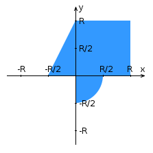

<div align="center">

# Laboratory 3


Web Programming · ITMO University · autumn 2026
Tserendorj Ariunbat · group P3213 · variant 777


[Report (PDF)](docs/report.pdf) · [Report (Word)](docs/report.docx)

</div>

---

## What this is

The whole app answers one question. Does a point land inside the area below or not?

You pick X, Y and R in a form, or just click somewhere on the graph, and the server checks the point and tells you. Every check stays in your session, so the table and the dots on the graph keep growing until you clear them.

It's the third lab of the course. Lab 1 was plain HTML and JS, lab 2 moved the check into a FastCGI server behind Apache, and this one moves everything into servlets and JSP running inside WildFly, split up following the MVC pattern.

## The area

<p align="center">
  
</p>


## Variant 777

| Input | How it's entered | Allowed values |
|---|---|---|
| X | text field | from −3 to 3, both ends excluded |
| Y | select | −2, −1.5, −1, −0.5, 0, 0.5, 1, 1.5, 2 |
| R | checkbox | 1, 1.5, 2, 2.5, 3 |

Requests go by **GET**, and the results are kept in the **HTTP session**.

## What it can do

- checks the form in the browser, and checks everything again on the server, because anyone can type a URL by hand
- lets you click the graph to check a point, as soon as R is picked
- draws every earlier check as a green or red dot, and lists them in a table
- clears your results with one button
- plays a background video on each page, with a different one for a hit, a miss and an error (made with [Remotion](https://www.remotion.dev/))
- switches the videos off when your system asks for reduced motion

## How a request travels

Every request lands in `ControllerServlet` first. It never builds a page itself, it only decides who should.


| Part | Role | File |
|---|---|---|
| Controller | decides where a request goes | `ControllerServlet` |
| Controller | validates the point, checks it, saves it | `AreaCheckServlet` |
| Model | the math, nothing else | `AreaChecker` |
| Model | one finished check | `Result` |
| View | form, graph and table | `index.jsp` |
| View | the result of one check | `result.jsp` |

`AreaCheckServlet` and both JSPs can't be opened straight from the address bar. The servlet answers 404 unless the controller forwarded to it, and the JSPs live in `WEB-INF`, where the browser can't reach.

## Project layout

```
lab3/
├── docs/
│   ├── images/area.png
│   ├── report.pdf
│   └── report.docx
├── src/main/
│   ├── java/lab3/
│   │   ├── controllers/     ControllerServlet, AreaCheckServlet
│   │   └── models/          AreaChecker, Result
│   └── webapp/
│       ├── media/           background videos and their posters
│       ├── script.js
│       ├── styles.css
│       └── WEB-INF/         index.jsp, result.jsp
├── pom.xml
└── README.md
```

---

## Running it on Helios

### What you need

- **JDK 17** or newer, both on your machine and on Helios (use `java -version` to check)
- [**Maven**](https://maven.apache.org/download.cgi)
- [**WildFly**](https://www.wildfly.org/downloads/) 27 or newer, since the code uses the `jakarta` packages
- your **Helios login** and the **portbase** you were given

In the commands below, swap these for your own values

| Placeholder | Meaning |
|---|---|
| `sXXXXXX` | your Helios login |
| `PORTBASE` | the first port of your range, for example 24000 |
| `wildfly-XX` | the WildFly folder name, it depends on the version you downloaded |

### 1. Build the war

```bash
mvn clean package
```

That gives you `target/lab3.war`. The name comes from `finalName` in the pom, and it also becomes the address, so the app ends up at `/lab3/`.

<details>
<summary><b>pom.xml</b></summary>

```xml
<project xmlns="http://maven.apache.org/POM/4.0.0">
    <modelVersion>4.0.0</modelVersion>

    <groupId>sai</groupId>
    <artifactId>lab3</artifactId>
    <version>1.0</version>
    <packaging>war</packaging>

    <properties>
        <maven.compiler.release>17</maven.compiler.release>
        <project.build.sourceEncoding>UTF-8</project.build.sourceEncoding>
        <failOnMissingWebXml>false</failOnMissingWebXml>
    </properties>

    <dependencies>
        <dependency>
            <groupId>jakarta.servlet</groupId>
            <artifactId>jakarta.servlet-api</artifactId>
            <version>6.0.0</version>
            <scope>provided</scope>
        </dependency>
    </dependencies>

    <build>
        <finalName>lab3</finalName>
        <plugins>
            <plugin>
                <groupId>org.apache.maven.plugins</groupId>
                <artifactId>maven-compiler-plugin</artifactId>
                <version>3.13.0</version>
            </plugin>
            <plugin>
                <groupId>org.apache.maven.plugins</groupId>
                <artifactId>maven-war-plugin</artifactId>
                <version>3.4.0</version>
            </plugin>
        </plugins>
    </build>
</project>
```

The servlet API is `provided` on purpose. WildFly already has it, so it stays out of the war.

</details>

### 2. Put WildFly on Helios

Grab the `.tar.gz` from [wildfly.org/downloads](https://www.wildfly.org/downloads/), copy it over and unpack it there.

```bash
scp -P 2222 wildfly-XX.tar.gz sXXXXXX@se.ifmo.ru:~/
ssh -p 2222 sXXXXXX@se.ifmo.ru
tar -xzf wildfly-XX.tar.gz
```

### 3. Move WildFly to your ports

Helios is shared by all of our university peers, so the default ports are almost surely taken. Open `~/wildfly-XX/standalone/configuration/standalone.xml`, scroll down to `<socket-binding-group>` and give every binding a port from your range.

### 4. Start it in standalone mode

```bash
cd ~/wildfly-XX/bin
nohup ./standalone.sh -b 0.0.0.0 > ~/wildfly.log 2>&1 &
```

| Piece | Why it's there |
|---|---|
| `standalone.sh` | the standalone mode the lab asks for |
| `-b 0.0.0.0` | opens the http listener to every IP, which the lab also asks for |
| `nohup` and `&` | WildFly keeps running after you log out |
| `> ~/wildfly.log` | everything WildFly prints goes into that file |

Then watch the log until a line with `started in` shows up.

```bash
tail -f ~/wildfly.log
```

### 5. Deploy the war

From your own machine

```bash
scp -P 2222 target/lab3.war sXXXXXX@se.ifmo.ru:~/
```

Then on Helios

```bash
cp ~/lab3.war ~/wildfly-XX/standalone/deployments/
ls ~/wildfly-XX/standalone/deployments/
```

To update the app later, just copy a new war over the old one and WildFly redeploys it by itself.

### 6. Open it

The easiest way to reach it from home is an SSH tunnel. Leave this running in its own terminal

```bash
ssh -p 2222 -L 9000:localhost:PORTBASE sXXXXXX@se.ifmo.ru
```

and open **http://localhost:9000/lab3/** in your browser. Port 9000 can be replaced by any free port you pick.

To stop WildFly

```bash
pkill -f jboss-modules.jar
```

---

## Report

The full report is in [docs/report.pdf](docs/report.pdf), and there's an editable [Word version](docs/report.docx) next to it.

## Links

- [Jakarta Servlet 6.0](https://jakarta.ee/specifications/servlet/6.0/)
- [Jakarta Pages 3.1](https://jakarta.ee/specifications/pages/3.1/), the spec behind JSP
- [Jakarta Standard Tag Library 3.0](https://jakarta.ee/specifications/tags/3.0/), the `<c:...>` tags
- [WildFly documentation](https://docs.wildfly.org/)
- [Remotion](https://www.remotion.dev/), what the background videos were made with
